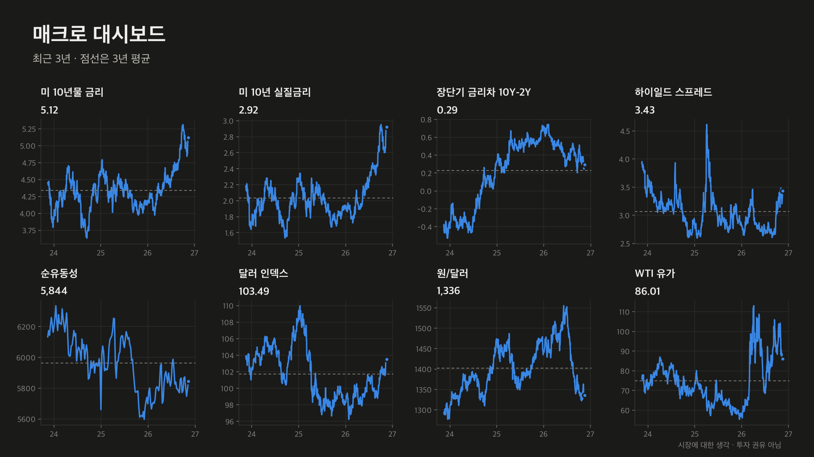
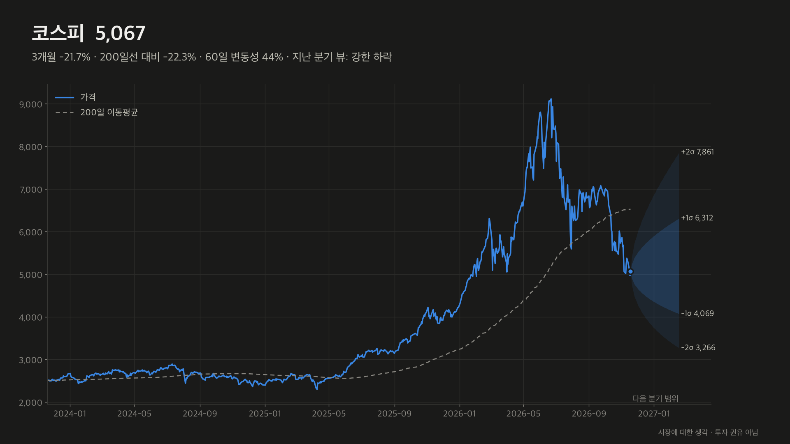
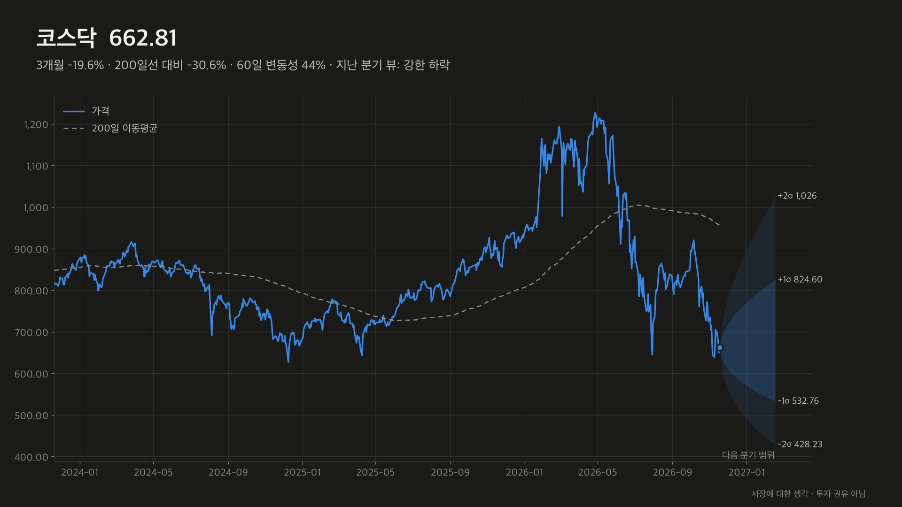
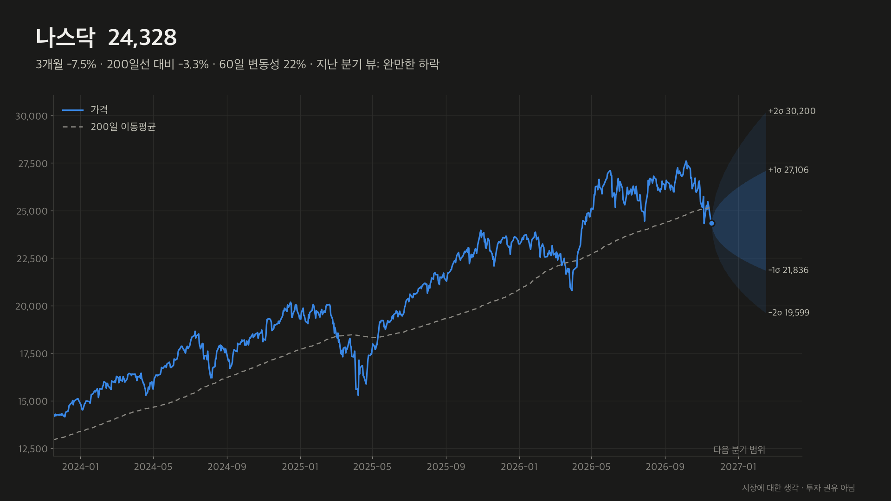
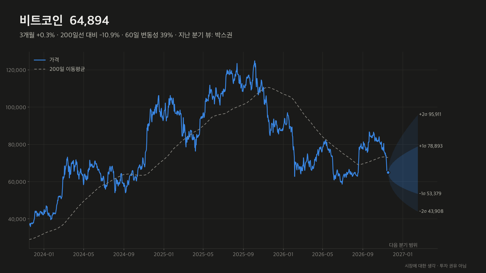
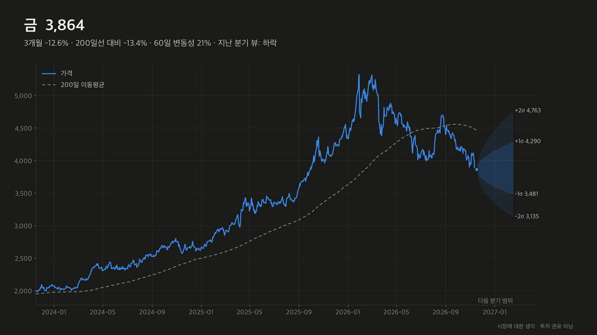
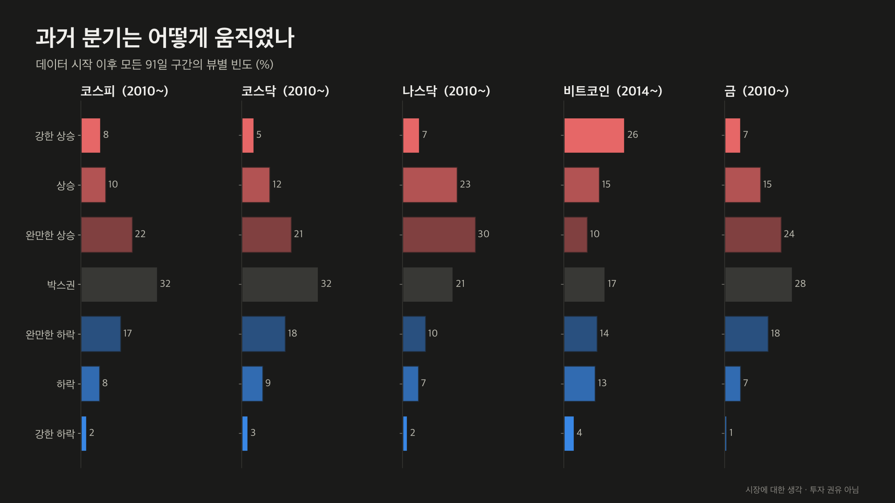

# 2026 Q4 시장 서한

> 작성일: 2026-11-19 · 만기: 2027-02-18 (91일 후)
> 기준값: 코스피·코스닥 11-18 종가, 나스닥·비트코인·금 11-17 종가 (모두 독립 출처 대조 완료)
> 데이터: `journal/snapshot_2026-11-19.md`
> 이 글은 개인적인 시장 기록이며 투자 권유가 아닙니다.

---

## 들어가며

한 달 전 코스피가 하루에 7.6% 빠졌을 때만 해도 한국만의 문제처럼 보였다. 지금은 아니다. 나스닥 -8.9%, 필라델피아 반도체 -16.7%, 비트코인 -21%. 10월 15일 이후 오른 건 달러와 VIX뿐이다.

그런데 숫자를 하나씩 뜯어보면 이상한 점이 있다. **AI 수요를 보여주는 지표는 오히려 좋아졌다.** 엔비디아는 가이던스를 넘는 실적을 내고 다음 분기 전망을 올렸고, 한국의 10월 반도체 수출은 역대 최대였다. 가격을 무너뜨린 건 수요가 아니라 **인물(엔비디아 CEO 사임), 정책(미국 AI 칩 규제), 금리(연준 인상 재개)** 였다.

이번 분기 내 생각은 한 줄이다. *펀더멘털과 가격의 괴리가 가장 큰 곳은 한국 반도체이고, 그 괴리는 다음 분기에 일부 좁혀진다. 다만 금리 인상기에 유동성에 가장 민감한 자산(비트코인, 코스닥)은 아직 바닥이 아니다.*

---

## 1. 매크로: 지금 어디에 있나

| 축 | 현재 | 10-15 대비 | 한 줄 해석 |
|---|---|---|---|
| 금리 (미 10Y) | 5.12% (10년 분위 99%) | +0.02%p | 명목금리 수준은 그대로, 부담은 여전히 최고 수준 |
| 실질금리 (10Y) | 2.92% (10년 분위 100%) | +0.14%p | 금융 여건은 조용히 더 조여졌다 |
| 기대인플레이션 (10Y) | 2.21% | -0.11%p | 유가 하락과 함께 성장 기대가 내려간다 |
| 정책금리 | 3.75~4.00% | 동결 | 12월 9일 인상이 거의 확실시, 50bp 가능성까지 거론 |
| 달러 (DXY) | 103.49 | +1.5% | 모든 위험자산이 빠질 때 홀로 상승 |
| 유가 (WTI) | 86.01 | -12.2% | IEA가 4분기 공급 과잉 전망 |
| 금 | 3,864.2 | -7.3% | 안전자산이 아니라 금리 자산처럼 움직인다 |
| 신용 (하이일드 스프레드) | 3.43%p (10년 분위 88%) | +0.20%p | 위험 회피가 신용으로 번지기 시작 |
| 변동성 (VIX) | 25.46 | +55% | 11-05 고점 28.18 |

**금리 인상기라는 점이 이번 분기의 전제다.** 연준은 9월에 이미 금리를 올렸고, 10월 28일 회의는 10대 2로 동결했지만, 10월 근원 CPI가 0.3%로 나오면서 12월 인상은 시장에 거의 다 반영됐다. 월러 이사는 "사람들을 놀라게 할" 50bp 인상까지 언급했다. 한국은행도 11월 26일 3.00%에서 3.25%로 올릴 거라는 전망이 우세하다.

과거 데이터로 보면 이 전제가 중요하다. 2010년 이후 **연준 인상 국면에서 200일선 아래에 있던 날**의 91일 뒤 성과는 다음과 같다.

| 자산 | 인상 국면 & 200일선 아래 중앙값 | 상승 비율 | 전체 기간 중앙값 |
|---|---:|---:|---:|
| 나스닥 | +3.8% | 65% | +4.8% |
| 코스피 | +0.1% | 50% | +1.5% |
| 코스닥 | +2.6% | 56% | +0.5% |
| 비트코인 | **-7.9%** | **40%** | +8.6% |
| 금 | +4.4% | 71% | +2.0% |

인상 국면에서는 "많이 빠졌으니 반등한다"는 통계가 약해진다. 비트코인은 아예 방향이 뒤집힌다. 금은 반대로 인상 국면에서 오히려 통계가 좋아지는데, 금리 충격으로 빠진 뒤 되돌림이 나온 경우가 많았기 때문이다.

### 이번 분기 핵심 뉴스와 지표 연결

| 뉴스/이벤트 | 움직이는 지표 | 영향 자산 | 방향 |
|---|---|---|---|
| 젠슨 황 엔비디아 CEO 사임 (11-12) | 엔비디아 주가 (10-06 대비 -35%), 반도체 지수 | 나스닥, 한국 반도체 | 하락 (일회성 지배구조 충격) |
| 미 상무부 AI 칩 수출 규제 (11-16) | 반도체 지수, 외국인 순매도 | 코스피, 나스닥 | 하락 (동남아 데이터센터 투자 지연) |
| 엔비디아 실적 (11-17): 매출 $115.8B, 4Q 가이던스 $130B | AI 수요 | 한국 반도체, 나스닥 | **상승 (수요는 훼손되지 않음)** |
| 한국 10월 반도체 수출 +259% (일부 영업일 효과) | 한국 수출 | 코스피 | 상승 |
| 외국인 코스피 순매도 (11/2~6주 10.4조 원) | 수급 | 코스피 | 하락 |
| 연준 12월 인상 기대, 월러 50bp 발언 | 실질금리, 달러 | 비트코인, 코스닥, 나스닥 | 하락 |
| 비트코인 현물 ETF 순유출 (11월 약 20억 달러 이상) | 코인 수급 | 비트코인 | 하락 |
| IEA 공급 과잉 전망 | 유가, 기대인플레이션 | (간접) 금리 기대 | 유가 하락 |
| 중앙은행 금 매입 3분기 321t (전년 대비 +42%), 금 ETF 3분기 211t 유입 | 금 실물 수요 | 금 | 상승 (하단 지지) |

---

## 2. 자산별 시각

### 코스피

- **현재 위치**: 5,067.44. 6월 고점 9,114 대비 -44.4%, 200일선 대비 -22.3%. 60일 변동성은 63%(10월)에서 44%로 내려왔다. 11-17에 4,968.48까지 밀렸다.
- **근거**
  - 데이터: 2010년 이후 코스피가 200일선보다 15% 넘게 아래에 있었던 경우는 독립 에피소드 6번(2011-08, 2018-10, 2020-03, 2022년 세 번)뿐이고, 91일 뒤 중앙값은 +5.9%, 상승 비율은 70%였다. 다만 표본이 작고, 인상 국면만 보면 중앙값이 +0.1%로 내려간다.
  - 매크로/뉴스: 하락의 직접 원인은 외국인의 반도체 매도(11월 첫 주에만 삼성전자·SK하이닉스 7.7조 원)다. 그 원인인 CEO 사임과 수출 규제는 수요가 아니라 심리와 정책 문제다. 같은 기간 엔비디아는 가이던스를 올렸고 한국 반도체 수출은 기록을 썼다. 삼성전자는 52주 고점 대비 -45.8%, SK하이닉스는 -60.1%다.
  - 걸림돌: 한국은행 인상 가능성, 연준 50bp 시나리오, 아직 확인되지 않은 저점.
- **뷰: 완만한 상승 / 목표 구간: 4,800 ~ 5,900**
- **시나리오**
  - 기본 (55%): 반도체 수출 지표가 유지되고 외국인 매도가 잦아들며 5,300~5,700 근처로 회복.
  - 강세 (20%): 연준이 25bp에 그치고 엔비디아 리더십 불확실성이 해소되면 6,000 회복 시도.
  - 약세 (25%): 50bp 인상과 외국인 매도 지속으로 4,700 아래로 저점 경신.
- **틀렸다고 인정할 조건**: 종가 4,700 하회. 또는 12월 1일 발표될 11월 반도체 수출이 전년 대비 크게 꺾일 때.

### 코스닥

- **현재 위치**: 662.81. 200일선 대비 -30.6%, 52주 고점 대비 -45.9%, 1개월 -18.1%. 11-09 저점 638.97.
- **근거**
  - 데이터: 200일선 대비 -20% 이하였던 7번의 에피소드에서 91일 뒤 중앙값은 +5.7%, 상승 비율은 78%. 낙폭 과대 통계만 보면 코스피보다 좋다.
  - 매크로/뉴스: 그러나 코스닥에는 코스피를 받쳐주는 반도체 수출 같은 펀더멘털 지지대가 약하다. 대신 금리와 유동성에 가장 민감하다. 한국은행과 연준이 동시에 올리는 국면에서는 반등 폭이 제한될 것으로 본다.
- **뷰: 박스권 / 목표 구간: 600 ~ 740**
- **시나리오**: 기본(55%) 620~720 사이 등락, 강세(20%) 금리 인상 종료 신호와 함께 750 이상, 약세(25%) 600 하회.
- **틀렸다고 인정할 조건**: 종가 600 하회, 또는 한국은행이 동결하고 매파 신호를 거둬들이는데도 반등하지 못할 때.

### 나스닥

- **현재 위치**: 24,328.38(11-17). 52주 고점 대비 -11.9%, 200일선 대비 -3.3%. 60일 변동성 22%로 한국보다 훨씬 안정적이다.
- **근거**
  - 데이터: VIX 25 이상이면서 200일선 아래였던 19번의 에피소드에서 91일 뒤 중앙값은 +6.6%, 상승 비율은 71%. 다만 2022년 인상기의 에피소드는 -7%, -8%, -8%로 대부분 마이너스였다.
  - 매크로/뉴스: 엔비디아가 4분기 매출 가이던스 $130B, 내년 성장률 전망 75%로 수요를 확인시켜 줬다. 반면 실질금리는 10년 최고 수준이고 하이일드 스프레드가 벌어지고 있다. 2022년과 다른 점은 이익 전망이 오르고 있다는 것이다.
- **뷰: 완만한 상승 / 목표 구간: 23,500 ~ 27,000**
- **시나리오**: 기본(55%) 실적이 금리 부담을 상쇄하며 25,000~26,000. 강세(20%) 12월 FOMC 이후 불확실성 해소로 고점 근처 회복. 약세(25%) 50bp와 신용 스프레드 확대로 23,000 아래.
- **틀렸다고 인정할 조건**: 종가 23,000 하회, 또는 하이일드 스프레드가 4%p를 넘을 때.

### 비트코인

- **현재 위치**: $64,893.95(11-17). 52주 고점 대비 -33.1%, 200일선 대비 -10.9%. 11-14 저점 $64,128.
- **근거**
  - 데이터: 인상 국면에서 200일선 아래였던 날의 91일 뒤 중앙값은 **-7.9%**, 상승 비율 40%. 내가 본 네 자산 중 유일하게 조건부 통계가 마이너스다.
  - 나스닥과의 60일 상관이 0.33에서 0.64로 올랐다. 지금 비트코인은 독립 자산이 아니라 레버리지 걸린 위험자산처럼 움직인다.
  - 수급: 현물 ETF에서 11월에만 20억 달러 넘게 빠졌고, 주말 사이 약 20억 달러 규모의 강제 청산이 나왔다.
- **뷰: 완만한 하락 / 목표 구간: $50,000 ~ $69,000**
- **시나리오**: 기본(50%) 12월 인상 후 $55,000~62,000에서 바닥 다지기. 강세(25%) ETF 자금이 다시 유입되며 $70,000 회복. 약세(25%) 나스닥이 함께 무너지면 $50,000 하회.
- **틀렸다고 인정할 조건**: 종가 $72,000 회복(200일선 근처), 또는 ETF 순유입이 2주 넘게 이어질 때.

### 금

- **현재 위치**: $3,864.2(11-17, CME 금 선물). 1월 29일 사상 최고(장중 $5,586, 종가 $5,318) 대비 종가 기준 -27.3%, 200일선 대비 -13.4%. 1월 30일 하루에만 -10.8% 급락한 뒤 하락 추세가 이어졌다. 60일 변동성 21%.
- **근거**
  - 데이터: 금 주간 수익률과 실질금리 변화의 상관은 최근 52주 -0.40으로 2010년 이후 평균(-0.36)보다 강하다. 달러와의 60일 상관도 -0.41. 올해 금은 안전자산이 아니라 **실질금리 자산**으로 움직였다. 그런데 실질금리가 10년 최고(2.92%)인 지금, 과거 통계는 오히려 반등 쪽이다. 연준 인상 국면에서 200일선 아래였던 날의 91일 뒤 중앙값 +4.4%, 상승 비율 71%. 실질금리가 3개월에 30bp 넘게 오르고 달러도 2% 넘게 오른 국면에서도 +4.0%, 71%.
  - 수급: 세계금협회(WGC) 기준 3분기 중앙은행 순매입 321t(전년 대비 +42%), ETF 211t 유입, ETF 보유량 사상 최대 4,256t. 가격이 빠지는 동안 실물 수요는 오히려 늘었다. 하락을 만든 쪽은 선물 시장의 레버리지 청산이다.
  - 걸림돌: 12월 인상이 50bp로 나오면 실질금리가 한 번 더 오른다.
- **뷰: 박스권 / 목표 구간: $3,600 ~ $4,150**
- **시나리오**: 기본(55%) 중앙은행 매입이 하단을, 실질금리가 상단을 막으며 $3,700~4,050에서 등락. 강세(20%) 12월 FOMC가 "마지막 인상" 신호를 주면 $4,200 이상. 약세(25%) 50bp 인상과 달러 강세로 $3,600 하회.
- **틀렸다고 인정할 조건**: 종가 $3,600 하회(실질금리 논리가 중앙은행 매입을 압도한 것), 또는 $4,200 상회(내가 반등 폭을 과소평가한 것).

---

## 3. 이번 분기 예측 요약

| ID | 자산 | 기준값 | 뷰 | 목표 구간 | 구간 폭 (1σ 대비) | 과거 빈도 (전체) | 과거 빈도 (비슷한 국면) |
|---|---|---:|---|---|---:|---:|---:|
| 2026Q4-01 | 코스피 | 5,067.44 | 완만한 상승 | 4,800 ~ 5,900 | 0.49 | 22% | 17% (200일선 -15% 이하) |
| 2026Q4-02 | 코스닥 | 662.81 | 박스권 | 600 ~ 740 | 0.48 | 32% | 29% (200일선 -20% 이하) |
| 2026Q4-03 | 나스닥 | 24,328.38 | 완만한 상승 | 23,500 ~ 27,000 | 0.66 | 30% | 21% (VIX≥25, 200일선 아래) |
| 2026Q4-04 | 비트코인 | 64,893.95 | 완만한 하락 | $50,000 ~ $69,000 | 0.74 | 14% | 22% (VIX≥25, 200일선 아래) |
| 2026Q4-05 | 금 | 3,864.2 | 박스권 | $3,600 ~ $4,150 | 0.68 | 28% | 24% (인상 국면, 200일선 아래) |

\* 과거 빈도는 같은 뷰가 91일 뒤에 실제로 나온 비율. 비슷한 국면 표본은 작아서(독립 에피소드 6~29개) 참고용이다.
\* 구간 폭은 목표 구간 폭 ÷ 기록 시점 다음 분기 1σ 범위 폭. 1보다 작을수록 변동성 대비 좁은(과감한) 구간이다.

**채점 (2027-02-18 종가 기준)**: 점수 = 뷰 점수(적중 1.0, 한 칸 차이 0.5, 그 이상 0) × 50% + 구간 적중 × 50%. 구간 폭은 점수에 넣지 않고 함께 공개한다. 예측은 `predictions.csv`에 기록했고 이후 수정하지 않는다.

## 4. 이번 분기 달력

| 날짜 | 이벤트 | 왜 중요한가 |
|---|---|---|
| 11-26 | 한국은행 금통위 | 3.25% 인상 여부. 코스닥 뷰의 핵심 |
| 11-29 | OPEC+ 회의 | 2027년 생산 전략. 유가와 기대인플레이션 |
| 12-01 | 한국 11월 수출입 동향 | 반도체 수출이 유지되는지. 코스피 뷰의 핵심 |
| 12-08~09 | FOMC | 25bp인가 50bp인가. 다섯 자산 모두에 영향. 금은 실질금리 경로가 곧 뷰 |
| 2027-02 중순 | 미 상무부 규제 라이선스 유예(90일) 종료 무렵 | 동남아 데이터센터 투자 차질의 실제 크기 |
| 미정 | 엔비디아 신임 CEO 선임 | 지배구조 불확실성 해소 |

## 맺으며

가장 확신하는 것: **한국 반도체의 가격은 펀더멘털보다 훨씬 많이 빠졌다.** SK하이닉스가 고점 대비 -60%인데, 같은 기간 고객사(엔비디아)는 성장 전망을 올렸다.

가장 자신 없는 것: **연준이 어디까지 올릴지.** 50bp가 나오면 위의 다섯 뷰가 모두 한 칸씩 아래로 밀릴 수 있다. 그래서 이번 분기에는 상승 뷰도 "완만한"에 머물렀다.

---

### 출처

- 코스피 외국인 매도·서킷브레이커: [Seoul Economic Daily](https://en.sedaily.com/finance/2026/11/08/kospi-sinks-117-percent-in-a-week-as-foreigners-dump-4), [Invezz](https://invezz.com/news/2026/11/06/kospi-crash-trading-halt-november-6/), [MoneyToday](https://www.mt.co.kr/en/stock/2026/11/16/2026111615390410324)
- 젠슨 황 사임: [CNBC](https://www.cnbc.com/2026/11/12/nvidia-nvda-jensen-huang-second-affair.html), [CNN](https://www.cnn.com/2026/11/17/tech/nvidia-earnings-jensen-huang-exit)
- 엔비디아 3분기 실적: [NVIDIA](https://nvidianews.nvidia.com/news/nvidia-announces-financial-results-for-third-quarter-fiscal-2027), [CNBC](https://www.cnbc.com/investingclub/2026/11/17/nvidia-takes-positive-step-forward-with-stronger-sales-outlook-heres-our-thoughts-on-the-stock.html)
- 미 상무부 AI 칩 규제: [Bloomberg](https://www.bloomberg.com/news/articles/2026-11-16/us-moves-to-limit-remote-access-to-advanced-ai-chips), [CNBC](https://www.cnbc.com/amp/2026/11/18/nvidia-us-ai-chip-export-controls-data-centers-.html)
- 연준: [Yahoo Finance (10월 FOMC)](https://finance.yahoo.com/economy/policy/live/fed-meeting-live-updates-interest-rates-held-steady-in-split-vote-warsh-says-politics-played-no-role-ahead-of-midterm-elections-191946928.html), [CNBC (월러)](https://www.cnbc.com/2026/11/18/federal-reserve-governor-christopher-waller.html)
- 한국은행: [Econotimes](https://econotimes.com/Bank-of-Korea-heads-toward-Nov-26-meeting-with-base-rate-at-3-1767873), [Kyunghyang](https://www.khan.co.kr/en/article/202610221648047/)
- 한국 10월 수출: [Korea Times](https://www.koreatimes.co.kr/economy/20261101/koreas-monthly-exports-hit-1153-bil-in-oct-on-record-chip-sales)
- 비트코인 ETF 유출: [CoinCentral](https://coincentral.com/bitcoin-btc-price-sinks-to-62000-as-etf-investors-pull-2-35-billion-in-november), [CryptoLinks](https://cryptolinks.com/news/bitcoin-etf-outflows-seven-sessions-november-2026)
- 금: [World Gold Council Q3 2026 Gold Demand Trends](https://www.gold.org/goldhub/research/gold-demand-trends/gold-demand-trends-q3-2026), [WGC 10월 코멘터리](https://www.gold.org/goldhub/research/gold-market-commentary-october-2026), [Euronews](https://www.euronews.com/2026/11/17/why-gold-and-silver-prices-have-fallen-to-their-lowest-in-over-a-year)
- 유가: [EnergyNow](https://energynow.com/2026/11/oil-prices-fall-for-second-straight-week-as-global-supply-surplus-emerges-wti-closes-at-88-56-brent-at-95-84/), [Offshore Technology](https://www.offshore-technology.com/news/oil-prices-fall-supply-surplus-gulf-tensions/)
- 가격·지표 데이터: yfinance·FinanceDataReader 수집, 네이버 금융(한국 지수·종목·금 선물)·FRED·바이낸스로 대조
